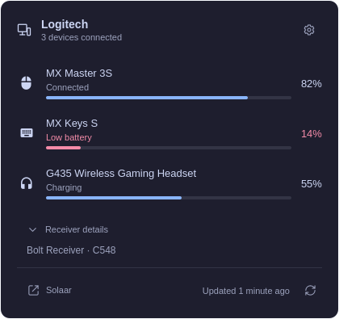

# Foamy Bolt

Logitech receiver and battery status for the Omarchy bar.



## Install

Requires Omarchy 4.5 (it also loads on 4.0), Python 3 and Solaar (`solaar`),
with Solaar able to access your receivers (its udev rules).

```sh
omarchy plugin add https://github.com/foamrider/foamy-bolt.git --enable
```

## Use

- Left-click the widget to see your devices and battery levels. Right-click opens Solaar.
- The bar shows the lowest battery when it is low (or always, or never; see Settings),
  and turns urgent below the threshold.
- Keyboard: arrows or hjkl move, Enter activates, `s` Settings, `r` Refresh,
  `o` Solaar, Esc closes (or leaves Settings), Tab/Shift-Tab switch to the
  neighbouring bar panel.
- Settings (the cog): layout (**List** or **Tiles**), show offline devices,
  low-battery threshold, **Show battery in the bar**, hide the widget without a
  receiver, and **Refresh every** (default 5 minutes).

Connection, disconnection, supported battery notifications and receiver
hotplug update the readings right away. Mouse movement and button events are
ignored. The refresh interval is only a fallback; opening the popup or
clicking Refresh always asks for a fresh reading.

Supports Bolt, Unifying and Lightspeed receivers. Direct Bluetooth and USB
devices are not discovered. Pairing and device configuration stay in Solaar.

## How it reads devices

One helper process per shell (`logitech_events.py`), however many monitors
and bars you have. It uses Solaar's Python library to listen for receiver
notifications and to read battery levels, and it reuses its open receiver
handles for every reading, so no second Python process is started. It does
not apply Solaar profiles or change pairing, and it leaves notification flags
on for Solaar.

- Hardware queries from foamy-bolt processes are serialized with a lock in
  `$XDG_RUNTIME_DIR/foamy-bolt/`. Solaar's own GUI can run at the same time;
  its requests use separate software IDs.
- Solaar has no stable Python API. The helper checks every Solaar name it uses
  when it starts. If the event API moved, readings continue on the refresh
  interval and the shell log says which names are missing. If the reading API
  moved, the popup says "This Solaar version isn't supported". Tested with
  Solaar 1.1.20; run `python3 tests/test_solaar_compat.py` after a Solaar
  upgrade.
- If the helper stops, it restarts after 30 seconds, doubling up to 10 minutes.
  Without Solaar it waits 5 minutes, then 10. Clicking Refresh starts it right away.
- The helper keeps device identifiers out of logs and runs without access to
  the display.

`python3 logitech_status.py` prints one reading as JSON, for debugging.

Settings clipboard paste uses `wl-paste`, `jq` and `timeout`, provided by Omarchy.
It accepts at most 16 KiB of plain text and stops clipboard reads after two seconds.

## Language

The plugin follows **Omarchy → Setup → Language** on Omarchy 4.5 (English and
Norwegian catalogs; other languages fall back to English, and right-to-left
languages mirror the popup). Omarchy 4.0 shows it in English.

## Development

`kit/` holds shared components copied from [foamy-kit](https://github.com/foamrider/foamy-kit); edit them there, not here.

Shared components come from [foamy-kit](https://github.com/foamrider/foamy-kit)
and live in `kit/` as stamped copies: change them in foamy-kit and run its
`sync.sh`, never edit them here.

```sh
node tests/model-test.js && node tests/i18n.test.cjs
python3 -I tests/test_logitech_events.py && python3 -I tests/test_logitech_status.py
python3 -I tests/test_solaar_compat.py        # against the installed Solaar, no hardware access
python3 -I tests/test_clipboard.py
python3 -I tests/runtime.py                   # offscreen on 4.0 and 4.5 (needs foamy-kit's harness)
bash tests/kit-check.sh
```

`preview/Preview.qml` holds mock states for foamy-kit's screenshot harness.

## Remove

```sh
omarchy plugin remove foamy.bolt
```

Removal stops the helper. Solaar, receiver pairing and device settings remain
installed and unchanged. Omarchy manages the plugin entry in `shell.json`.
Versions before 1.1 kept a reading cache in `~/.cache/foamy-bolt/`; it is no
longer used and can be deleted.

## License

Licensed under [MIT](LICENSE). Omarchy and Lucide notices are in
[LICENSE-OMARCHY](LICENSE-OMARCHY) and [LICENSE-LUCIDE](LICENSE-LUCIDE).

Provided **as is**, without warranty or guaranteed support. Use at your own risk.
